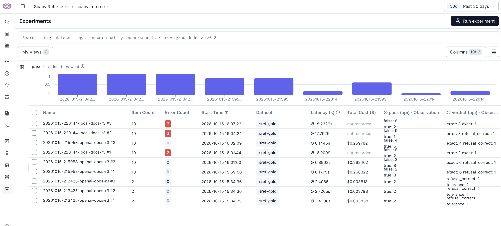

# SREF — Observability Tools

What the tracing tools observe, what each one does, and how they are used in
AI applications, learned by walking SREF's own traces through each tool.

Shorthand used throughout: **smith** = LangSmith · **fuse** = Langfuse ·
**phx** = Arize Phoenix.

---

## 1. The project in brief

SREF (Soapy Referee) is an evaluation harness for a small AI agent that
answers NBA questions by writing SQL against a frozen database. Each answer
is graded by running a known-correct "gold" query and comparing the result
rows. The harness is the product; the agent is the thing it measures. More
in [overview.md](overview.md).

Every run produces two records of what happened:

- **The run record** (`runs/<run_id>/`) — SREF's own file, one row per case.
  The source of truth.
- **Traces** — the same run, step by step, sent to smith, fuse and phx. The
  lens for looking inside each case.

---

## 2. OpenTelemetry and OpenInference

The three tools are three different products, but SREF writes its tracing
code once. Two open standards make that possible.

### OpenTelemetry (OTel) — the plumbing

A vendor-neutral standard for recording what software does and shipping it
somewhere. It defines:

| Concept | What it is | In data terms |
|---|---|---|
| **Span** | One timed step: a name, start, end, status, attributes | A row |
| **Trace** | All the spans from one request, sharing a `trace_id` | Rows grouped by a key |
| **Parent span** | The step that called this one | A self-referencing foreign key (`parent_span_id`) |
| **Attributes** | Key-value facts on a span (`llm.model_name = qwen2.5-coder:14b`) | Sparse columns |
| **Status** | OK or ERROR, plus any exception recorded | A flag column |
| **Exporter** | Sends finished spans to one destination | A loader |
| **OTLP** | The wire format exporters speak | The file format of the load |

OTel says nothing about AI. It was built for web services: a span could be
an HTTP request or a database call. It knows nothing about prompts, tokens or
models.

### OpenInference — the AI vocabulary on top

A set of attribute-naming conventions, created by Arize (makers of phx), that
gives OTel spans an AI meaning. In data terms: OTel is the table and the
loader; OpenInference is the **data dictionary** that every tool agrees to
read the columns by.

| Attribute | Meaning |
|---|---|
| `openinference.span.kind` | What kind of step: `LLM`, `CHAIN`, `TOOL`, `EVALUATOR`, `RETRIEVER`, `AGENT` … |
| `input.value` / `output.value` | What went into the step and what came out |
| `llm.model_name`, `llm.provider` | Which model, from where |
| `llm.input_messages.*` / `llm.output_messages.*` | The prompt and reply as role/content messages |
| `llm.token_count.prompt` / `.completion` / `.total` | Token usage |
| `llm.invocation_parameters` | Model settings (temperature, seed, context size) |
| `session.id` | Groups traces into a conversation or, for SREF, a run |
| `metadata`, `tag.tags` | Free-form context and labels |

### How they fit with smith, fuse and phx

The tools name the same things differently — a span is a *run* in smith and
an *observation* in fuse. The full translation is in §5.

```
SREF runner ── OTel spans with OpenInference attributes
                 │
                 ├── OTLP exporter ──► phx    (localhost:6006)
                 ├── OTLP exporter ──► fuse   (localhost:3100)
                 └── OTLP exporter ──► smith  (cloud)
```

All three accept OTLP, and all three read OpenInference attributes, so each
one turns the same spans into its own screens. Each maps them to its own
vocabulary: an OpenInference `LLM` span becomes a **GENERATION** in fuse and a
run of type **llm** in smith. phx reads them natively, since it defined them.

**Why not use each tool's own SDK?** Each tool has a Python SDK that handles
tracing, but each SDK writes only to its own tool. Three SDKs would mean three
sets of tracing code, and the agent's code would be tied to a vendor. With
OTel + OpenInference, the instrumentation is written once and switching tools
is a configuration change. The trade-off: no tool gets anything beyond the
shared vocabulary, so tool-specific features, such as fuse's own tag and
metadata fields, may need extra attributes.

How SREF sets this up is in [code_inventory.md](code_inventory.md)
(`tracing.py`); ports and keys are in [infra.md](infra.md).

---

## 3. What is in the tools

### The shape of one trace

One trace per case attempt. One session per run, keyed by `run_id`.

```
<case_id>                 CHAIN       question in, SQL out, verdict in metadata
├─ build_prompt           CHAIN       assemble system prompt + schema + question
├─ generate_sql           LLM         the model call: messages, model, tokens, settings
├─ execute_sql (gold)     TOOL        run the gold query
├─ execute_sql (agent)    TOOL        run the agent's query
└─ compare_rows           EVALUATOR   grade agent rows against gold rows
```

A trace stops early when a step ends the case. A refusal has no SQL to run;
an agent query that fails never reaches `compare_rows`.

### The 12 traces

Every trace is filed in project `soapy-referee` in each tool.

**Session `20261002-173747-local-docs`: the full run, 10 traces.** The
`local-docs` config gives the agent the documented schema. 2 of 10 passed.

| Case | Verdict | In brief |
|---|---|---|
| `all-star-average-score` | wrong | Filters on one spelling of "All-Star" |
| `all-star-game-count` | wrong | Same spelling trap |
| `attendance-leader-2014-15` | subset | Agent query returned no rows |
| `best-home-record-1996-97` | **exact** | Correct — the clean path |
| `biggest-improvements` | subset | Built on an empty table, no rows |
| `fewest-points-in-a-quarter-2018-19` | error | Agent SQL failed to run |
| `lakers-ppg-2022-23` | wrong | **Silent failure:** runs cleanly, returns one row holding NULL — filters on `'Lakers'` (stored as `'Los Angeles Lakers'`) and on home games only |
| `player-salary-refusal` | **refusal_correct** | Correctly declined: no salary data exists |
| `single-game-scoring-high-2015-16` | error | Agent SQL failed to run |
| `top-rebounding-teams-1982-83` | wrong | Right idea, wrong shape |

The first trace's model call took ~111s; the rest took 1–7s. That is the
model loading the 17,000-token schema prompt cold, after which Ollama reuses
it. Expect one latency outlier at the top of every session.

**Session `20261001-174431-local-columns`: a test run, 2 traces.** The
`local-columns` config gives the agent bare column names only. These two
traces were used to confirm tracing worked: `best-home-record-1996-97` (error)
and `player-salary-refusal` (refusal_correct).

smith and fuse also hold one `smoke-test` trace from setup; it can be ignored.
The verdicts and the reasons behind them are in [findings.md](findings.md).

### The cases followed through every tool

| Case | Why |
|---|---|
| `best-home-record-1996-97` (full run) | All five steps, a clean pass |
| `lakers-ppg-2022-23` | Wrong, with nothing in the trace marked red |
| `fewest-points-in-a-quarter-2018-19` | Error, with an exception on the agent's `execute_sql` |
| `player-salary-refusal` | Optional: a three-span trace, no SQL run |

---

## 4. The tools

Filled in during the walkthrough, one view at a time, from screenshots.

### smith — LangSmith

**Vocabulary.** smith calls every span a **run**: the case is a run, and so is
each step inside it. That collides with SREF's own "run" (one pass over the
gold set). Here, "smith run" means a span.

#### Tracing → project `soapy-referee` (the home screen)

**Top navigation**

| Item | What it is |
|---|---|
| **Tracing** | The project's traces. Where everything below lives |
| **Evaluators** | Rules that score traces automatically, by code or an LLM judge. Phase 6 territory |
| **Automations** | Rules that act on incoming traces, e.g. send matching ones to an annotation queue or a dataset |
| **Insights** *(Plus)* | Paid tier: clusters traces to surface common topics and failure patterns |
| **Engine** *(Plus)* | Paid tier |
| ⚙ | Project settings |
| **Retention 14d** | Free-tier traces are deleted after 14 days. The run record in `runs/` is what lasts — the reason it is the source of truth |
| **Dashboard** | Charts over the project: trace counts, latency, tokens, errors |

**Above the table**

| Control | What it does |
|---|---|
| **Last 1 day** | Time window. Older traces, such as the setup `smoke-test`, fall outside it, which is why exactly 12 show |
| **Threads · Traces · Runs** | Three ways to cut the same spans. **Traces**: one row per trace, i.e. root spans only. **Runs**: one row per span, every step (63 here). **Threads**: traces grouped into conversations |
| **Views** | Saved filter-and-column combinations |
| Filter icon | Filter on any field — name, status, latency, tokens, metadata (e.g. `case_id`, `config`) |
| Columns icon | Pick which columns show. Latency, tokens, start time and more sit to the right of Output |

**The table — one row per trace**

| Column | Comes from | Here |
|---|---|---|
| Checkbox | — | Select traces to bulk-add to a dataset or annotation queue |
| Status icon | smith's own error flag | Green for all 12. See below |
| **Name** | Root span name | The case id |
| **Input** | `input.value` on the root | The question |
| **Output** | `output.value` on the root | The agent's SQL, or its refusal text |

Two rows appear twice: `best-home-record-1996-97` and `player-salary-refusal`.
The lower pair is from the test run on the bare-columns config, which is why
their SQL and refusal wording differ.

**Green does not mean correct.** Every row is green, including four wrong
answers and two errors.

- **smith's status means "did code throw?"** smith marks a run as an error
  only when the span records an exception. The agent's failing
  `execute_sql` spans are red, since the query raised one. Their parent
  case is green: SREF caught that exception and set the case's status to
  ERROR without raising, and smith does not read OTel status alone. phx
  does, and shows those two cases as errors.
- **No tool can know a wrong answer is wrong.** `lakers-ppg-2022-23` ran
  cleanly and returned one row (holding NULL, as it turns out). Nothing
  crashed, so to any tracing tool it is a success. Only the comparator knows. This is the silent failure
  SREF exists to measure, and it is invisible at the level of trace status.
  Today the verdict travels as metadata (`sref.verdict`, `metadata.verdict`),
  which can be filtered on but is not shown as pass/fail. Showing correctness
  in the tool means sending verdicts as **feedback scores**, smith's native
  grade. Sent since 2026-10-05 (§5, *Grades in the tools*).

smith reads SREF's `metadata` JSON into its own metadata fields (`case_id`,
`attempt`, `config`, `verdict`), unlike fuse, which keeps it as a raw
attribute.

#### The trace view — `lakers-ppg-2022-23`

Opened by clicking a row. Left: the span tree. Right: details of whichever
span is selected — the root, until another is clicked.

**Header bar**

| Item | What it is |
|---|---|
| `>>` · ⛶ | Collapse the side panel · full screen |
| ˅ ˄ | Previous / next trace in the list, without going back |
| ↻ | Reload |
| Name + **ID** | The trace name, and a copy button for smith's id. smith builds its UUID from the OTel span id: `…-d4c5-c96227f1bfd7` is `OTEL_SPAN_ID` `d4c5c96227f1bfd7` |
| `···` · share · copy | More actions, share a link, copy |
| **Trajectory · Details** | Details is the span-by-span view shown here. Trajectory lays the steps out as an agent's path |
| ✎ · database icon | Annotate · add this trace to a **dataset** (a saved set of examples to re-run or evaluate later) |

**Left panel — the span tree**

| Row | Kind in smith | Shows |
|---|---|---|
| `lakers-ppg-2022-23` | chain (root) | — |
| `build_prompt` | chain | 0.00s |
| `qwen2.5-coder:14b` | **llm** | 2.45s · 17.06K tokens |
| `execute_sql` | tool | 0.03s — gold's query |
| `execute_sql` | tool | 0.01s — the agent's query |
| `compare_rows` | chain | 0.00s |

- **The LLM step is labelled by model, not by name.** smith shows an llm run
  as its `llm.model_name`; the span is `generate_sql` underneath.
- **Tokens appear only on the LLM row:** 17,058 = 17,019 prompt + 39 output.
  Nearly all of it is the schema block. The question and reply are a few
  dozen tokens.
- **The two `execute_sql` rows look identical.** SREF tags each with
  `sref.role` (gold / agent), but smith drops custom attributes outside
  `metadata`, so the only way to tell them apart is order (gold runs first)
  or the SQL in each one's Input.
- **`compare_rows` shows as a chain.** smith has no evaluator run type, so
  OpenInference's `EVALUATOR` falls back to chain.
- **Filter runs…** searches the steps of this trace; the sliders and gear set
  what each row displays.
- Durations are wall-clock per step. The 2.45s model call is the whole
  trace, near enough. The SQL steps are hundredths of a second.

**Right panel — the root span**

| Section | What it holds | Here |
|---|---|---|
| **Feedback** | Scores attached to this run — by a person, an evaluator, or code via the API | Empty here. Since 2026-10-05 it holds `verdict` and `pass`, the first section on the root (§5, *Grades in the tools*) |
| **Input** | `input.value` | The question. smith renders a plain string as a **User** chat message. *Markdown* is only the display format |
| **Output** | `output.value` | The agent's SQL, wrapped by smith as a field called `text`. *Plain* is the display format |
| **Attributes → Metadata** | Everything smith kept beyond input and output | See below |

The Output is the silent failure in full: `AVG(pts_home)` (home games only),
`team_name_home = 'Lakers'` (stored as `'Los Angeles Lakers'`, so no rows
match), and a `LIKE` with no wildcard (works as `=`). It returns one row
holding NULL. Nothing errors.

**Attributes → Metadata**

| Key | Source | Meaning |
|---|---|---|
| `OTEL_SPAN_ID` | OTel | This span's id: 16 hex characters |
| `OTEL_TRACE_ID` | OTel | The trace's id: 32 hex, shared by every span in the trace |
| `run_id`, `case_id`, `attempt` | SREF metadata | **The join key** back to the run record: `runs/20261002-173747-local-docs/`, the `lakers-ppg-2022-23` row, attempt 1 |
| `config`, `tier` | SREF metadata | Which run config; which tier of gold case (`trap`) |
| `verdict`, `detail` | SREF metadata | The comparator's grade (`wrong`) and why. One row × one column on both sides, so the shape matched; the value did not |
| `otel.resource.*` | OTel resource | Facts about the *process* that sent the spans, stamped on every span: service `sref`, project `soapy-referee`, SDK `opentelemetry` 1.45.0 for Python, and `service.instance.id` — a fresh id each time the runner starts |
| `ls_run_depth` | smith | Depth in the tree: 0 for the root, 1 for its steps |

#### The LLM span — `generate_sql`

Selected by clicking the `qwen2.5-coder:14b` row. The panel title shows the
span's real name, `generate_sql`, with an orange LLM icon.

| Section | What it holds | Here |
|---|---|---|
| **Feedback** | As on the root, but per step | Empty. Steps can be graded separately from the whole trace |
| **Input** | What the model was sent | One **User** message, 46,401 characters: all 16 schema tables, then `Question: …` on the very last line |
| **Output → text** | The model's raw reply, verbatim | The SQL wrapped in a ```` ```sql ```` fence, with a trailing `;` |
| **Output → usage_metadata** | Token counts | `input_tokens` 17,019 · `output_tokens` 39 · `total_tokens` 17,058 |
| **Attributes → Metadata** | OTel ids and resource | A new `OTEL_SPAN_ID` (`afaddbf8…`), the **same** `OTEL_TRACE_ID` as the root (`2e7c3a9a…`), and no SREF metadata — that lives on the root only |
| **Attributes → LangSmith** | smith's own fields | `ls_model_name` qwen2.5-coder:14b · `ls_run_depth` 1 (one level below the root) |
| **Attributes → Invocation Params** | `llm.invocation_parameters` | The run config's model settings, below |

**Invocation params** — the knobs on the model call, all from the run config:

| Param | Value | Meaning |
|---|---|---|
| `temperature` | 0 | No randomness — always take the most likely next token |
| `seed` | 0 | Fixes the random number generator, for whatever randomness remains |
| `num_ctx` | 32768 | Context window: the most tokens the model reads at once. The prompt uses 17,019 |
| `num_predict` | 512 | Output cap. The reply used 39 |

What this span shows:

- **The prompt is almost all schema.** Of 17,019 input tokens, the question
  is about 20. Scroll to the bottom of Input to find it. This is the cost of
  the `docs` schema mode, and why the first call of each run is slow: the
  model reads all 17,000 tokens cold once, then Ollama reuses them.
- **The model broke an instruction, and the trace shows it.** The system
  prompt says "no markdown fences". The reply has one anyway. SREF's parser
  strips fences before running the SQL, so the case did not fail on it —
  but the raw reply is preserved here and in the run record.
- **smith dropped the system prompt.** SREF sends both messages
  (`llm.input_messages.0` system, `.1` user), but smith displays only
  `input.value`, which SREF sets to the user message. So the instruction the
  model broke is not visible in smith. Leaving `input.value` off the LLM span
  would likely make smith fall back to the message list. Fixed 2026-10-05
  (lesson 2): smith now shows both messages.
- **Tokens are smith's to count, cost is not.** smith maps the token
  attributes into `usage_metadata`, and would multiply by a price for a
  hosted model. A local Ollama model has no price, so cost stays empty.
- **Trace id and span id are the join, in miniature.** Every span in the
  trace carries the same `OTEL_TRACE_ID` and its own `OTEL_SPAN_ID`. In SQL:
  `GROUP BY trace_id` gives the trace; `span_id` is each row's key.

#### Finding errors — `fewest-points-in-a-quarter-2018-19`

> **In smith, errors are buried unless someone goes looking.** With SREF's current
> wiring, a failed case looks green on the Traces tab (lesson 1 in §6). The
> error sits on one step inside the trace, behind an Error tab that only
> appears on that step. Opening every trace and clicking every step is not a
> workflow. Use one of these instead:
>
> 1. **Runs tab + a status filter.** Runs lists every span, not just trace
>    roots. Open **Shortcuts** (left of the table) → **Status** → tick
>    **error**, which adds `status:error` to the search bar. The table drops
>    to the failing steps across all traces, with an **Error** column holding
>    each message, and **Stats** shows the count (3 runs here: two from the
>    full run, one from the test run). **Save View** keeps it one click away.
>    Shortcuts also filters by **Run Name** and **Run Type**.
> 2. **Fix the wiring.** Recording the caught exception on the root span
>    (lesson 1) makes failed cases red on the Traces tab, the first screen.
> 3. **Dashboard** charts the error rate over time; **Automations** can route
>    erroring traces to a queue. Useful at volume.

The failing step, selected:

| Section | Here |
|---|---|
| **Error** | Shown only on spans that recorded an exception: `Binder Error: Referenced column "season_id" not found in FROM clause!` The `>` expands the full message and candidate columns |
| **Feedback** | Empty |
| **Input** | The agent's SQL. smith renders it as a **User** message: it shows any plain-string input that way, even on a database step |
| **Output** | Empty. The query never returned |

**Two mistakes, stacked.** `line_score` has no `season_id` column (the
season lives on `game`), so the query fails at bind time. It also asks for
`'21819'`, which is not a valid season code, so even with the column fixed it
would have returned nothing. The first mistake is why this case is an
`error` and not a silent `wrong`.

**The tree is short.** No `compare_rows`: with no agent rows there is
nothing to grade, so the trace ends at the failure. Gold's `execute_sql`
(0.04s) ran first and succeeded.

#### After the wiring fixes (2026-10-05)

Run `20261005-180454-local-docs`, traced with the §6 fixes applied.

- **Errors on the first screen (lesson 1).** The two failed cases are red on
  the **Traces** tab, with an **Error** column: `agent SQL failed: Binder
  Error: …`. Inside the trace the root has its own **Error** tab. The project
  list on smith's Home now reports an **error rate** (9%: 2 of 23 traces,
  since the older runs predate the fix).
- **Threads (lesson 3).** The run is one thread: **10 turns**, Thread ID =
  the `run_id`, with first input, last output and **Last Error** across the
  run. smith models a session as a chat conversation, so each case is a
  "turn"; the Turns panel becomes a numbered list of the run's cases, a
  quick way to step through one run.
- **Steps named apart (lesson 6).** `execute_sql.gold` and
  `execute_sql.agent` in the tree.
- **System prompt (lesson 2), tags (lesson 4), step metadata (lessons 5 and
  7):** confirmed through smith's API: the LLM input is a `messages` list,
  system then user, and every step carries the join keys plus its own fields
  (`role`, `rows`, `truncated`, `done_reason`).

**What smith did not keep.** `session.id`, `tag.tags`, and the `sref.*`
attributes (`sref.verdict`, `sref.role`, `sref.done_reason`) do not appear:
smith's tag list is empty and nothing groups the traces into a thread. smith
groups threads by a `session_id`, `thread_id` or `conversation_id` key in
metadata, so adding `session_id` to SREF's metadata JSON would fill the
**Threads** tab. Anything that must survive in smith belongs in `metadata`.

**To check:** smith's API returns every span attribute in the run's stored
metadata under `otel.span.*` (for example `otel.span.langfuse.release`). So
smith may store custom attributes and only leave them off screen, rather than
drop them (lesson 5). Seen through the API on 2026-10-05; not yet checked in
the UI.

### fuse — Langfuse

Shared concepts are covered under smith; this section covers what fuse does
differently.

**Vocabulary.** fuse calls every span an **observation**, typed by what it
is: **GENERATION** (a model call, from OpenInference `LLM`), plus SPAN, CHAIN,
TOOL, EVALUATOR and others. A **trace** is a tree of observations; a
**session** groups traces.

#### Home (the dashboard)

fuse opens on a dashboard. smith keeps charts on a separate page; phx puts a
few above the trace list.

**Top bar:** organisation / project, the time window (**Past 1 day**: the
test run and setup trace are older, so 10 traces show), **Env** (fuse can
split traces by environment, such as dev and prod; everything here is
`default`), **Filters**, and a dashboard picker with an edit pencil:
dashboards are customisable.

**Left navigation**, grouped by purpose: **Observability** (Tracing,
Sessions, Users, Alerts) · **Prompt Management** (Prompts, Playground) ·
**Evaluation** (Scores, Evaluators, Human Annotation, Datasets, Experiments).
The Evaluation group is Phase 5–6 territory, as in the other tools.

| Widget | Here | What it says |
|---|---|---|
| **Traces** | 10, one per case name | Volume by trace name. Each case ran once in the window |
| **Model costs** | qwen2.5-coder:14b · 170.82K tokens · $0 | Tokens summed over the 10 model calls (~17K each). $0 because fuse has no price for a local model. Custom prices can be set in Settings |
| **Scores** | 0 | fuse's native grades. Empty here; filled since 2026-10-05 (§5, *Grades in the tools*) |
| **Observations by Level** | 55 · DEFAULT 51 · ERROR 4 | 55 spans in the 10 traces. **ERROR 4** = the two failing agent `execute_sql` steps plus their two root spans: fuse reads OTel status as phx does, not as smith does |
| **Model Usage** | $0, no data | Cost by model and type. Empty without prices |
| **User consumption** | Unknown | Cost per user. SREF sends no `user.id` |
| **Trace latency percentiles** | `all-star-average-score` 1m 50s; the rest 4–7s | p50/p90/p95/p99 per trace name. With one trace per name, all four are equal. The 1m 50s is the first case of the run: the cold model call |
| **Generation latency percentiles** | `generate_sql` p50 4.30s · p90 17.09s · p95 1m 03s · p99 1m 41s | The useful row: all 10 model calls together. The median is ~4s; the tail is the one cold call. The case-named rows above and below it are the root CHAIN observations, which this widget appears to include alongside generations |
| **Observation latency percentiles** | by type and name | The same, per observation, labelled with its type (CHAIN …) |
| **Model latencies** | p50–p99 over time for qwen2.5-coder:14b | Model-call latency as a time series |
| **Scores Analytics** | no data | Score averages over time. Phase 5–6 |

**What the home page shows:**

- **The tail tells the story, not the median.** `generate_sql`'s p50 is 4.3s,
  but its p99 is 1m 41s: one cold call in ten. A run's wall-clock time is
  dominated by that one call. Percentiles make that visible; an average would
  blur it into "about 15s each".
- **Cost and users are empty for good reasons:** a local model has no
  price, and an eval harness has no users. In a hosted chat app these would be
  the headline widgets.
- **fuse counts errors from status,** so the ERROR level appears on the
  dashboard without any extra wiring.

#### Tracing (the list)

**The list is observations, not traces.** fuse v4 lists every span by default,
like smith's Runs tab or phx's Spans tab. The footer says **Total ≈ 55**. To
get one row per trace, as on smith's Traces tab, untick **False** under
**Is Root Observation** in the Filters panel, which leaves the 10 root spans.

**Above the table**

| Control | What it does |
|---|---|
| **Search** | A query language: `level:ERROR`, `-env:dev`, `latency:>2`, `scores.accuracy:>0.8`. `level:ERROR` is the one-line error view smith needs a filter panel for |
| **Quality · Slow · Cost** | Preset filters: low scores, high latency, high cost |
| **My Views** | Saved filter-and-column sets, as in smith |
| **Table · Chart** | The rows, or the same filter as a chart |
| **Columns 16/34** | 34 columns available, 16 shown |
| Download icon | Export (failing in this install) |
| **Count** | Observations over time. Both bars sit around 11:40, the full run |

**Filters panel** lists values with counts, and doubles as a summary of the
run:

| Name | Count | Why that number |
|---|---|---|
| `execute_sql` | 18 | 9 answering cases × (gold + agent). The refusal ran no SQL |
| `build_prompt`, `generate_sql` | 10 each | One per case |
| `compare_rows` | 7 | 10 cases − 2 whose agent SQL failed − 1 refusal |
| each case name | 1 | One root per case |

**The table**

| Column | Comes from | Here |
|---|---|---|
| Start Time | span start | |
| **Type** | `openinference.span.kind` → fuse type | Icons: link = CHAIN, swirl = GENERATION, wrench = TOOL, wand = EVALUATOR. fuse keeps the EVALUATOR kind, which smith does not |
| Name | span name | |
| **Trace Name** | the root's name | Filled on root rows only |
| Input · Output | `input.value` · `output.value` | `generate_sql` output shows the raw ```` ```sql ```` fence; `build_prompt` output shows `prompt v1, 46,428 chars` |
| **Metadata** | everything else, as one JSON blob | Starts `{"scope.name":"sref","r…`. Unparsed: SREF's metadata, resource and custom attributes are all inside, as raw text |
| **Status** | OTel status → fuse **level** | **Error** on four rows: the two failing `execute_sql` steps *and* their two cases. Default on the rest |

What the list shows:

- **Errors are marked on both levels.** fuse flags the step that raised and
  the case whose status SREF set. phx does the same; smith flags only the
  step. Sorting by Status, or searching `level:ERROR`, lists all four.
- **The verdict is visible without opening anything.** `compare_rows`'s
  output is the verdict and its reason (`wrong: gold 2 rows × 2 cols, agent 1
  rows…`, `subset: agent return…`). Filter Name to `compare_rows` and the
  table is the run's report card, one row per graded case. The same trick
  works on smith's Runs and phx's Spans.
- **Metadata is there but buried.** It is one long string per row, not
  columns. Readable in the trace view; not filterable as fields here.

**The Filters panel, in full.** Some 50 filters, in a few groups. Most of the
empty ones belong to features SREF does not use.

| Group | Filters | In SREF today |
|---|---|---|
| Structure | Is Root Observation, Name, Type, Trace Name, Trace ID | All populated. Type: CHAIN 20, TOOL 18, GENERATION 10, EVALUATOR 7 (= 55) |
| Grouping | Session ID, User ID, Environment, Trace Tags | Session ✓ (the run). User empty: no users. Environment all `default`. Tags ✓: `tag.tags` arrives as trace tags (shown in the trace header) |
| Outcome | Status, Status Message | ✓ Error / Default, and messages such as "agent SQL failed" or the Binder Error |
| Model | Provided Model Name, Model ID | Name ✓. Model ID is fuse's price-list match; a local model is not on it |
| Performance | Latency, Time To First Token | Latency ✓. TTFT empty: SREF does not stream replies |
| Tokens & cost | Input / Cached Input / Output / Total Tokens; Input / Cached / Output / Total Cost | Tokens ✓. Cached stays 0: Ollama reuses the schema prefix but does not report it separately. Costs $0, with no price |
| Tool calling | Tool Names (Available / Called), Available Tools, Tool Calls | Empty. For models that call functions themselves; SREF's `execute_sql` is a harness step, not a model tool call |
| Prompt management | Prompt Name, Version, Release | Empty. Prompts stored in fuse, and app version / release labels. SREF's prompts live in `agent/prompts/` |
| Grades | Numeric / Categorical / Boolean Scores, Comment Count / Content | A verdict maps naturally to a **categorical** score plus a **boolean** pass — what SREF sends since 2026-10-05 |
| Experiments | Experiment Dataset ID / ID / Name | Phase 5 |
| Provenance | API Key, SDK Name / Version, Ingestion Source | Which key and library sent the span: `opentelemetry`, over OTLP |
| Metadata | Metadata | SREF's JSON is one raw string in fuse, so field-level filtering likely fails. Check in the trace view |

#### The trace view — `lakers-ppg-2022-23`

**Header:** the raw OTel **trace id**, then 2.49s, **17,058 tokens** (rolled
up to the whole trace), a **session ↗** link to the run, and the **tags**
`local-docs` and `trap` as chips. Download, open in a new tab, close.

**Left:** the span tree, with three layouts: **Tree** (shown), **Timeline**
(a waterfall: each step as a bar on a time axis, showing where the 2.49s
went) and **Graph** (steps as connected nodes, built for branching agents).
**Search** finds text across the trace.

**Right, for any selected step:**

| Item | What it is |
|---|---|
| **Add to** | Add this observation to a **dataset** or an **annotation queue** |
| **Annotate** | Attach a score by hand |
| **Comment** | A free-text note, counted in the Comment filters |
| Timestamp · duration · tokens | Tokens only on steps that have them |
| **Preview: Formatted / Raw** | Input and output. Formatted shows input as **User** and output as **Assistant**, on every step |
| **Correct output** | Record what the output *should* have been: a human-written reference, the raw material for a dataset |

**What each step shows** — read in order, the trace explains the failure:

| Step | User (input) | Assistant (output) |
|---|---|---|
| root | the question | the agent's SQL |
| `build_prompt` | the question | `prompt v1, 46,401 chars` |
| `generate_sql` | the schema block and question; model `qwen2.5-coder:14b` shown above | the raw reply |
| `execute_sql` (0.03s) | **gold's SQL**: home and away games via `UNION ALL`, `team_id` `1610612747`, rounded | `1 rows` |
| `execute_sql` (0.01s) | **the agent's SQL**: home games only, `team_name_home = 'Lakers'` | `1 rows` |
| `compare_rows` | — | `wrong: gold 1 rows × 1 cols, agent 1 rows × 1 cols` |

What the trace view shows:

- **Gold and agent side by side is the diagnosis.** The two `execute_sql`
  steps show the correct query next to the wrong one: gold unions home and
  away games by team id; the agent filters home games by a name that does
  not match. Both return one row, which is why the shape check passed and
  only the value failed.
- **The system prompt is missing here too.** fuse stores `input.value` (the
  user message) as the LLM step's input, as smith does, so the system
  message never appears. phx is the only tool showing both (lesson 2).
- **User / Assistant labels are generic.** fuse, like smith, labels every
  input User and every output Assistant, including the SQL steps. Read them
  as input / output.
- **Tags arrive at trace level.** `tag.tags` shows as chips on the trace,
  though fuse's API did not return them on the observation (lesson 4,
  corrected).
- **Gold SQL travels in traces**, including to smith's cloud. That is fine
  for people reading them. Traces must never become agent context, for
  example as Playground or prompt examples: non-negotiable 2, no leaks.

#### Experiments (added Phase 7)

Seen 2026-10-15 on dev run `20261015-213425-openai-docs-r3` (2 cases × 3
attempts, `--experiment`). How SREF builds them is in §6.

**Experiments list** (Evaluation → Experiments): one row per experiment,
`<run_id> #N`, with item count, error count, dataset (`sref-gold`), mean
latency and total cost. Above it, a bar chart of one score per experiment
(`pass`, oldest to newest), and filters on dataset, metadata and scores.



**One experiment:** a row per dataset item. Columns are **Input** (the
question), **Expected Output** (the gold rows from that run, e.g. `1 row /
ppg / 117.2`), and the experiment's cell: **Scores** (`pass`, `verdict`),
latency, cost, status and **Output** (the agent's rows or refusal).
**Summary** at the top rolls the scores up over the page: `pass` as a
percentage, `verdict` as its most common value with a count.

**Compare:** pick a **Baseline** and one or more **Compare** experiments.
Each gets its own column beside the shared Input and Expected Output. The
summary adds, per compared experiment, **↗ n ↘ n** — items whose `pass` rose
or fell against the baseline — and **↻ n** for items whose `verdict`
changed. Per item, latency and cost show their difference from the
baseline (`+0.329s`, `-$0.0000`).

- **This is the Phase 7 comparison screen.** Same dataset items, arms side by
  side, gold answer in the middle, and the regressions counted.
  ↘ is the per-item version of what a regression gate checks.
- **Expected Output is the gold run in that experiment,** not a stored
  answer. Compared arms share one Expected column (presumably the baseline's). With
  a frozen snapshot both arms' gold is the same.
- **Output is cut to the cell;** scroll inside it or open the trace (↗) for
  the full answer and the SQL.

### phx — Arize Phoenix

Concepts shared with smith (trace list, span tree, input and output, metadata)
are covered in the smith section above. This section covers what phx does
differently.

**Vocabulary.** phx uses the OTel words: a **span** is a step, a **trace** is
a tree of spans. smith's "Runs" tab is phx's **Spans** tab; smith's "Threads"
is phx's **Sessions**.

**The headline difference: phx shows what was sent.** smith keeps the
attributes it recognises and drops the rest. phx keeps every attribute, so
custom keys (`sref.verdict`), tags and `session.id` all appear. That makes phx
the best place to check the instrumentation itself: if a field is missing in
phx, it was never sent.

#### Projects (the landing page)

One card per project. phx files traces into a project by the
`openinference.project.name` resource attribute, and creates the project the
first time a new name arrives. That is how `sref-smoke` appeared: the setup
test sent a different name.

| Card field | `soapy-referee` | Meaning |
|---|---|---|
| Traces | 12 | Root spans in the time window (**Last 7 Days**, top right) |
| Sessions | 2 | Distinct `session.id` values: the full run and the test run. phx groups by OpenInference `session.id` directly, which smith does not (lesson 3) |
| Latency P50 | 4.3s | Median trace duration. Half the traces were faster |

**Left navigation:** Tracing (projects), Dashboards, Datasets & Experiments,
Evaluators, Prompts, Playground, Chat, plus **REST API** and **GraphQL**, the
same data over an API. **Ask PXI** is phx's built-in AI assistant.

#### Project → Traces tab

**Tabs:** **Spans** (every step, like smith's Runs) · **Traces** (root spans
only) · **Sessions** (traces grouped by `session.id`) · **Metrics** · **Config**
(project settings, such as retention).

**Charts at the top**, unlike smith, where charts live on a separate
Dashboard:

| Chart | Here |
|---|---|
| **Traces** — volume per day, split **error** (red) and **ok** (grey) | 10/1: 2 traces, 1 error (the test run). 10/2: 10 traces, 2 errors. "ok" includes spans whose status was never set |
| **Trace latency** — percentiles over time | Max near 2 minutes on 10/2: the cold first call. P50 stays low. One slow outlier drags Max and P99, not the median, which is why percentiles beat averages |
| **Trace annotation scores** | "No data". Annotations are phx's native grades, the equivalent of smith's feedback. Phase 5–6 |

**Filter bar:** a Python-style expression, not a menu. The placeholder's
`num_spans >= 5` is a real example. Expressions can reach any attribute, such
as `status_code == 'ERROR'` or a metadata value like the verdict. The sparkle
icon writes a filter from plain English.

**The table:**

| Column | Comes from | Here |
|---|---|---|
| **status** | OTel status | **ⓘ red on the three error cases.** phx reads the status SREF set on the root, so errors show on the first screen — no Runs filter needed (contrast lesson 1). "—" means status was never set |
| **kind** | `openinference.span.kind` | `chain` for every root |
| name · input · output | span name, `input.value`, `output.value` | As in smith |
| **error** | the status message | `agent SQL failed`, the message SREF set |
| **user** | `user.id` | Empty: SREF has no users. Relevant to chat apps |
| further right | — | Span count, latency, tokens, cost |

#### The trace view — `lakers-ppg-2022-23`

**Header:** the **trace ID** is the raw OTel trace id
(`2e7c3a9a2b610c3bfa9d7e7dac28268a`); smith converts ids into UUIDs. Then
**Status** (Unset), **Total Cost** ($0: a local model has no price),
**Latency** (2.4s), and **View Session**, which opens the whole run around this
trace.

**Span tree (left):** labelled by **span name** (`generate_sql`, not the model
as in smith), each kind with its own icon and colour. **`compare_rows` keeps
its EVALUATOR kind** (purple pencil), where smith falls back to chain
(lesson 9). The two `execute_sql` steps still look alike (lesson 6).
**Search trace** finds text across every span; the stopwatch toggles each
span's latency.

**Selected span (right):** kind badge, name, status, then the **span id**
(`d4c5c96227f1bfd7`, the same id smith shows as `OTEL_SPAN_ID`), start time
and duration. The icons are: open in **Playground** · add to a **dataset** ·
download the span.

| Tab | What it holds | Here |
|---|---|---|
| **Info** | Annotations, Input, Output, Metadata | **Annotations 0** with a pencil to add one by hand (**2** since 2026-10-05: `pass`, `verdict`). Input: the question. Output: the SQL. **Metadata:** SREF's JSON shown as a formatted block, with the join key and verdict |
| **Attributes** | Every attribute on the span, raw. **Table** or **JSON**, searchable | 14 on the root (below) |
| **Events** | Timed events on the span — chiefly recorded exceptions | 0 here. An erroring `execute_sql` will show 1 |

**Attributes tab — all 14, exactly as sent:**

| Key | Value | Note |
|---|---|---|
| `session.id` | `20261002-173747-local-docs` | Kept — smith dropped it |
| `metadata.run_id` … `metadata.detail` | the join key, config, tier, verdict, detail | phx flattens the metadata JSON into dotted keys |
| `openinference.span.kind` | CHAIN | |
| `sref.verdict` | wrong | **Kept** — a custom attribute smith dropped |
| `input.value` · `output.value` | question · SQL | |
| `tag.tags.0` · `tag.tags.1` | `local-docs` · `trap` | Kept, as a list. Shown here rather than as tag labels |

#### The LLM span — `generate_sql`

**Header:** an **llm** badge, status, span id (`afaddbf807039163`), start
time, 2.4s, and **17,058** tokens. phx puts the token count in the header;
smith puts it in the tree.

**Input**, labelled with the model (`qwen2.5-coder:14b`), with a
**Messages / Raw** toggle:

| Block | What it is |
|---|---|
| **Prompt Template** | From `llm.prompt_template.version` (`v1`). SREF sends only the version, not the template text, so there is little inside. smith does not show it at all |
| **Invocation Params** | temperature 0, seed 0, num_ctx 32768, num_predict 512, summarised on one line |
| **system** | **The full system prompt**, including "no markdown fences". smith hid it (lesson 2) |
| **user** | The schema block and the question. Very long, as in smith |

**Output → assistant** (Messages / Raw): in Markdown mode phx turns the
model's ```` ```sql ```` fence into a syntax-highlighted SQL block. It looks
clean, which hides the fact that the model broke the "no fences" rule;
**Raw** or **Text** shows the reply exactly as returned.

**Attributes:** 17 on this span, all as sent: `llm.prompt_template.version`,
`llm.output_messages.0.message.role` and `.content`, the token counts,
`sref.done_reason` and the rest.

What this span shows:

- **The rule and the broken rule are on one screen.** The system prompt says
  "no markdown fences" and the reply has one. In smith the system prompt was
  missing, so this mismatch could not be seen.
- **phx prefers the message list over `input.value`.** SREF sends both, and
  phx renders the messages. So lesson 2's fix, dropping `input.value` from
  LLM spans, is for smith's benefit and costs phx nothing.
- **Text vs Markdown matters on long prompts.** Markdown rendering runs the
  schema's line breaks together into one paragraph; **Text** keeps the
  layout the model actually saw. Use Text to read a prompt, Markdown to read
  prose.
- **Replay is one click away.** The ▶ icon at top right opens this exact call
  in phx's **Playground**, where the prompt or settings can be edited and the
  call re-run. smith has the same idea. Useful for prompt work later, not
  needed now.

#### Evaluators, Datasets & Experiments — for Phases 5–6

phx's Evaluators page draws the eval loop: a **dataset** of examples (input,
reference, metadata) → a **task** produces output → an **evaluator** (LLM or
code) compares output to reference → a **score**. That is SREF's loop: gold
set → agent → comparator (code) or judge (LLM) → verdict.

- **Not usable as-is.** phx's task is a Playground prompt, a model call that
  cannot run SQL against the snapshot. Its built-in code evaluators
  (exact_match, contains, regex) would compare SQL *text*, against
  non-negotiable 3: gold is executed and result rows are compared.
- **Usable from code.** Load the gold set as a phx dataset, then run the SREF
  runner as an **experiment** through phx's Python client, with SREF's agent
  plus execution as the task and SREF's comparator as the evaluator. The
  Experiments view then compares configs case by case (columns vs docs,
  repeats). **Annotations** can hold Phase 5's hand labels; the Phase 6 judge
  could run as an LLM evaluator validated against them.
- **Same rules apply.** Logic stays in SREF's code and the run record stays
  the source of truth; phx is the screen. smith and fuse offer the same
  dataset / experiment / evaluator trio.
- **Outcome.** fuse owns the gold dataset and the experiments (Phase 7);
  phx's datasets, experiments and evaluators were not used.

---

## 5. How they compare

**The headline: all three tools show what the code did; none can show
whether the answer was right.** `lakers-ppg-2022-23` ran cleanly, returned one
row, and looks healthy in every tool, yet the answer is wrong. Trace status
means "did code throw", not "was it correct". Correctness exists only in
SREF's comparator. To see it in a tool, the verdict has to be sent as that
tool's native grade (a smith feedback score, a fuse score, a phx annotation).
SREF does this since 2026-10-05; see *Grades in the tools* below.

**The second finding: instrumenting once worked.** One set of OTel +
OpenInference spans reached all three tools, and each built its own screens
from them. The differences come from what each tool chooses to show, not
from what was sent. Closing them took a handful of tool-specific attributes
alongside the shared ones, not separate instrumentation (§6).

### Translation matrix

The same idea goes by different names in each tool, and sometimes by
different attribute keys. "?" means not checked in this walkthrough.

**A. Same concept, different names**

| Concept | OTel / OpenInference | smith | fuse | phx |
|---|---|---|---|---|
| One step | span | **run** | **observation** | span |
| A tree of steps | trace | trace | trace | trace |
| A group of traces (an SREF run) | session | **thread** (its cases are "turns") | session | session |
| Where traces are filed | resource `openinference.project.name` | tracing project ("session" in its API) | project | project |
| A model call | LLM span | llm run | **generation** | LLM span |
| A grading step | EVALUATOR span | chain (no evaluator type) | evaluator | evaluator |
| Step outcome | status: unset / OK / error | status: success / error | **level**: default / error (also debug, warning) | status: unset / OK / error |
| Why it failed | exception event | Error tab and column | status message | Events tab, error column |
| Every step, one row each | — | **Runs** tab | **Tracing** (default view) | **Spans** tab |
| One row per trace | — | **Traces** tab | Tracing, Is Root Observation = True | **Traces** tab |
| Labels | tags | tags | trace tags | tags (in Attributes) |
| Free-form context | metadata | metadata | metadata | metadata |
| Where a run happened | `deployment.environment.name` | ? (usually a separate project) | **environment** | ? (usually a separate project) |
| Which code produced it | `service.version` | ? | **release** (and version) | ? |
| A grade on a trace | — | **feedback** | **score** (numeric, categorical, boolean) | **annotation** |
| A note from a person | — | ? | comment | ? |
| A saved set of examples | — | dataset | dataset | dataset |
| Running a dataset through the app | — | experiment | experiment | experiment |
| An automated grader | — | evaluator | evaluator | evaluator |
| A review list for people | — | annotation queue | annotation queue (Human Annotation) | ? |
| Re-run one model call | — | playground | playground | playground |
| A saved filter | — | view | view (My Views) | ? |
| Charts | — | Dashboard, Monitoring | dashboards (home is one) | charts on the trace list, Dashboards, Metrics tab |
| Trace and span ids | 32- and 16-character hex | its own UUIDs: the OTel span id, zero-padded | raw OTel ids | raw OTel ids |

**B. Same field, different attribute keys** — what to send so each tool
reads it. SREF sends every key in the row's SREF column.

| Field | OpenInference key | smith reads | fuse reads | phx reads | SREF sends |
|---|---|---|---|---|---|
| Step kind | `openinference.span.kind` | ✓ (or `langsmith.span.kind`) | ✓ | ✓ | OpenInference |
| Input · output | `input.value` · `output.value` | ✓; parses JSON when `input.mime_type` says so | ✓ | ✓ | OpenInference |
| LLM messages | `llm.input_messages.*` | shows `input.value` instead | shows `input.value` instead | ✓ | both: messages, and `input.value` as a JSON message list |
| Model · tokens · settings | `llm.model_name` · `llm.token_count.*` · `llm.invocation_parameters` | ✓ | ✓ | ✓ | OpenInference |
| Session | `session.id` | `metadata.session_id` (or `thread_id`, `conversation_id`) | `session.id` (or `langfuse.session.id`) | `session.id` | both |
| Tags | `tag.tags` | `langsmith.span.tags`, comma-separated | `tag.tags` (or `langfuse.trace.tags`) | `tag.tags` | both |
| Metadata | `metadata` (a JSON string) | parses it (or `langsmith.metadata.*`) | `langfuse.observation.metadata.*` / `langfuse.trace.metadata.*` | parses it | both |
| Any other attribute | — | dropped | kept, unparsed | kept, all visible | none: everything goes in metadata |
| Error | status + exception event | the exception event only | status → level | status | both |
| Environment | `deployment.environment.name` (resource) | ? | ✓ | ? | the resource attribute |
| Code version | `service.version` (resource) | ? | `langfuse.release` | ? | both |
| Prompt version | `llm.prompt_template.version` | ✗ | `langfuse.version` | ✓ | both |
| User | `user.id` | ? | `user.id` (or `langfuse.user.id`) | `user.id` | none: SREF has no users |
| Project | resource `openinference.project.name` | the `Langsmith-Project` export header | set by the API keys | ✓ | all three |

### Side by side

| | smith | fuse | phx |
|---|---|---|---|
| **Runs where** | Cloud, free tier; data leaves the machine | Self-hosted, six containers | Self-hosted, one container |
| **Retention** | 14 days | As long as the volumes last | As long as the volume lasts |
| **Default list** | Traces (one row per case) | Every observation (55); filter to roots for traces | Traces, with charts above |
| **Errors on the first screen** | ✗ only steps that raised; needs Runs + `status:error` | ✓ on the step and the case | ✓ on the step and the case |
| **System prompt on the LLM step** | ✗ | ✗ | ✓ |
| **Custom attributes** (`sref.*`) | Dropped | Kept, inside a raw metadata string | Kept, all visible |
| **SREF metadata** | ✓ parsed into fields | Raw JSON string | ✓ parsed and flattened |
| **Tags** | ✗ | ✓ trace chips | In Attributes only |
| **Sessions (a run)** | ✗ without a `session_id` metadata key | ✓ | ✓ |
| **`compare_rows` (EVALUATOR)** | Shown as chain | ✓ evaluator | ✓ evaluator |
| **LLM row labelled by** | Model name | Span name | Span name |
| **Ids** | Its own UUIDs, built from OTel ids | Raw OTel | Raw OTel |
| **Filtering** | Panel with Shortcuts | Query language (`level:ERROR`) and ~50 filters | Python expressions, or plain English |
| **Charts** | A separate Dashboard | An editable home dashboard; latency percentiles per name | Volume, errors and latency above the trace list |
| **Native grades** | Feedback | Scores (numeric, categorical, boolean), comments, Correct output | Annotations |
| **Datasets · experiments · evaluators** | ✓ | ✓ | ✓ |
| **Replay an LLM call** | Playground | Playground | Playground, ▶ from the span |

### What it takes to run them

Footprint is a cost, not a feature: each extra service is one more thing to
install, secure, upgrade, back up and debug.

| | smith | fuse | phx |
|---|---|---|---|
| **Runs as** | Nothing local; a hosted service | Six containers: web, worker, Postgres, ClickHouse, Redis, MinIO | One container |
| **Storage behind it** | LangChain's cloud | Four stores, one per job (below) | One embedded database (SQLite by default) |
| **Images to download** | — | 5.8 GB | 1.6 GB |
| **Memory at idle** | — | 4.1 GB, 2.3 GB of it ClickHouse | 0.45 GB |
| **CPU at idle** | — | ClickHouse alone 35–140% of a core | Under 1% |
| **Disk used by the same traces** | — | 8.9 GB, of which SREF's data is 1.4 MB | 26 MB |
| **Secrets to set** | One API key | Seven internal (database passwords, encryption keys), plus the project's API keys and a login | None |
| **Setup** | Sign up, paste a key | A compose file with health checks and start order; compose refuses to start until `infra/.env` is complete | One compose service |
| **Ongoing care** | None, but traces leave the machine and are deleted after 14 days | Two app images and four databases to upgrade together; ClickHouse's disk to watch | One image to upgrade |

**Why fuse needs four stores.** Each does one job in an ingestion
pipeline, the same shape as a small ELT stack:

| Store | Job | Data-world analogy |
|---|---|---|
| MinIO | Raw events land here first | The landing zone (an S3 raw bucket) |
| Redis | Queue between web app and worker | A message queue |
| ClickHouse | Traces, spans and scores, queried by the UI | The warehouse (columnar) |
| Postgres | Projects, users, keys, datasets, score configs | The app's transactional database |

The web app writes incoming spans to MinIO and queues a job in Redis; the
worker loads them into ClickHouse. phx keeps everything in one database, which
is why it is one container.

**The weight is mostly ClickHouse looking after itself.** SREF's traces,
scores and datasets take 1.4 MB in ClickHouse. Its own system tables take
6.8 GB, 6.2 GB of it `trace_log`: ClickHouse profiling its own code, not
SREF's traces despite the name. Add 1.4 GB of log files, and it keeps working
with no traffic at all. None of that is SREF's data; it is the cost of
running a production analytics database for a few thousand spans.

**For SREF the weight was worth it** because fuse alone kept a model's draft
label apart from a person's review (*Labelling by hand* below). A project
that only needs to read traces would get most of that from phx, at a
fraction of the footprint.

*Measured 2026-10-19 on this machine, after every SREF run had gone to all
three: images and volumes from `docker system df`, memory and CPU from
`docker stats` sampled with no traffic about 16 minutes after start, and
ClickHouse's split from `system.parts`. Docker had 7.7 GB of memory to give.*

### Grades in the tools

Added 2026-10-05. `evals/scores.py` sends each attempt's verdict as two grades
on the root of its trace: `verdict` (categorical, with the comparator's detail
as the comment) and `pass` (boolean, the runner's pass line). It sends them
after the run, from the run record, which now keeps each row's `trace_id` and
root `span_id`. First graded run: `20261005-194042-local-docs-r3`, 60 grades
per tool, each read back through the tool's API.

| | smith | fuse | phx |
|---|---|---|---|
| **Native name** | feedback | score | annotation |
| **Sent to** | `POST /api/v1/feedback` | `POST /api/public/scores` | `POST /v1/span_annotations` |
| **Attached by** | run id: the root's OTel span id zero-padded into a UUID (`15d103ff9f2dfc5d` → `00000000-0000-0000-15d1-03ff9f2dfc5d`) | raw OTel trace id | raw OTel span id of the root |
| **Re-sending** | Same id answers 409; SREF patches it | Upsert by id | Upsert by name and span |
| **Trace list** | **Feedback** column, one chip per grade: `pass 0.00`, `verdict subset` | Not on the list by default; score columns under **Columns** (?) | **annotations** column: `pass μ 0.00`, with `verdict` behind "+1" |
| **Trace view** | **Feedback**, the first section on the root | Chips in the trace header beside the tags: `pass False`, `verdict error`; a speech-bubble icon holds the comment | On the root row in the tree, and Info → **Annotations 2** |
| **Every grade in one place** | Shortcuts → **Feedback** filters (`pass` 0 / 1, each verdict) | **Evaluation → Scores**: one row per score with value, comment, source, author, level and trace link, plus a count chart (columns below) | ? |
| **`pass` shown as** | 0.00 / 1.00 | False / True | μ 0.00 / 1.00, the mean per name |
| **Reading grades back** | `GET /api/v1/feedback?run=…` | Only `GET /api/public/v3/scores`. This deployment's v4 runs in *events_only* mode: `/scores`, `/v2/scores` and `/traces` return 404. The v3 response leaves out `traceId`; SREF's score id starts with it | `GET /v1/projects/{project}/span_annotations?span_ids=…` |
| **Retention** | Feedback sent without `extend_trace_retention`, so the trace stays at 14 days | — | — |

What the grades showed:

- **Status and grade now disagree on screen, as they should.** A green tick
  or OK status sits next to `pass 0`: status says the code did not throw, the
  grade says the answer was wrong. Lesson 8 is closed in all three tools.
- **Each tool keeps the grade in a different place.** smith on the root run,
  phx on the root span, fuse on the trace itself, so in fuse it shows in the
  trace header, not on the root row. That follows from what each API attaches
  a grade to.
- **phx averages by default.** μ is built for many grades per name; with one
  grade per trace it is just the value.
- **Phase 5 labels made in fuse come back through `/v3/scores`.** None of
  the older read endpoints work on this deployment.

### Labelling by hand

Added 2026-10-09. Phase 5's first labelling round, run as a bake-off: the
same two failures from `20261005-211049-local-docs-r3` labelled in each tool
with one label, `fault` (categorical: `agent`, `question`, `gold`,
`harness` — whose problem the failure is), plus a one-line note.

- **`lakers-ppg-2022-23` #1:** A person writes the label from scratch.
- **`all-star-game-count` #1:** A model drafts the label through the API,
  marked as a model draft; a person reviews it in the UI.

The second is **pre-labelling**: a model drafts, a person checks. It is how
the remaining failures were labelled, so how each tool handles a draft
decided the tool.

| | phx | fuse | smith |
|---|---|---|---|
| **Defining the label** | Settings → Annotations → New Annotation Config. Category numbers optional; direction None | Settings → score config. A number per category required (0–3) | From the run: + Add feedback → new feedback config. A number per category required |
| **Applying a label** | Root span → Annotations → pencil → pick a value, **explain** for the note, save | Root row → **Annotate** → pick a value; **saves on selection**; note via the comment icon | Feedback → **+ Add feedback** → pick a value; **saves on selection**; **no field for a note** |
| **Attached to** | The root span | The selected step (an observation), not the trace | The root run |
| **Reviewing a draft** | Edit form opens pre-filled with the draft; saving **overwrites** it, and it becomes HUMAN | The form ignores the draft (source API); the review is a **second** score beside it | **Not possible here.** The picker hides a key the run already has, and the card has no edit |
| **Who made a label** | `annotator_kind` HUMAN / LLM, through the API only | On the **Scores** page, per row: Source (ANNOTATION / API), Author (the person, or **U** for an API key) and Metadata (`drafted_by`). In the trace, a `{ }` chip | Hand label: Created by + **Source: User**. Draft: **Created by:** the API key's owner, by name, no Source |
| **Reading the note** | Hover the chip; Annotations → Table per trace | Hover the speech bubble; **Evaluation → Scores** lists every score with its comment | The feedback card ("Reasoning"); no list of comments across runs |
| **A mistake** | A mis-click saved `question` for `agent`; caught in the list | Saved the moment a value is picked | Saved the moment a value is picked |

What it showed:

- **fuse's Scores page is the review screen.** With all columns on, one row
  per grade shows who and what at a glance, which none of the other tools
  does in one place (2026-10-12):

  | Column | Shows | In SREF |
  |---|---|---|
  | Trace · Observation | The trace, and the step the grade is on | Labels have both; `pass` / `verdict` have no observation |
  | Score ID | The grade's id | SREF sets readable ids (`<trace id>-fault-draft`); hand labels get random ones |
  | Data Type | Categorical, Boolean or Numeric | `fault`, `verdict` categorical; `pass` boolean |
  | Source | What sent it | **API** (code and the model's drafts) or **ANNOTATION** (a person in the UI) |
  | Level | **Trace** or **Observation** | The two-level split, made visible |
  | Environment · Trace Tags | Run type; the trace's tags | `eval`; config and tier |
  | Author | The person | The reviewer's name on hand labels; **U** (unknown) on anything sent with an API key |
  | Metadata | Extra fields on the grade | Drafts carry `drafted_by: claude, status: draft` |
  | Comment | The note | Readable without hovering |
  | Execution Trace · Evaluator | fuse's own automated evaluators | Empty: none used |
  | Session · User | The trace's session; the app's end user | Empty: scores carry no session, SREF has no users |

  Source plus Author separates a model's draft from a person's review
  without opening anything: API / U / `drafted_by: claude` against
  ANNOTATION / the reviewer's name.
- **Draft-then-review needs the draft and the review kept apart.** Only fuse
  keeps both, so the record shows where the person agreed and where they
  changed the label. phx keeps only the last word. smith keeps the draft and
  offers no way to review it.
- **smith makes a machine label look human.** Feedback sent with an API key
  shows as created by the key's owner. The model source and the draft
  metadata are stored, but the card shows neither; only a missing "Source"
  row gives it away. Anyone auditing labels in smith would count a model's
  draft as a person's.
- **Notes are second-class everywhere.** On the trace, every tool hides the
  note behind a hover or a click, and smith's quick flow has no note at all.
  Only fuse's Scores page lists notes in one place.
- **Two of three save on selection.** No save button means no moment to
  catch a mis-click. phx has one and still let a mis-click through; the list
  view caught it.
- **fuse grades at two levels.** Code-sent `pass` and `verdict` are trace
  scores (chips in the trace header); a hand label from Annotate is a step
  score (on the root row). Same trace, two places. Sending SREF's grades to
  the root step would put them together.
- **Setup was easy in all three:** about two minutes each, no code.
- **No tool gives the whole picture.** Question, both answers, verdict,
  label, note and who made it sit across several views in every tool. Read
  back into the run record, they fit in one table; the eval report reads
  them from there.

**Outcome:** fuse is SREF's only labelling tool from 2026-10-12, with its
annotation queues for the remaining failures. Traces still go to all three.
phx is second; smith is not suited to reviewing drafts.

### What each is best at

- **phx — checking the instrumentation and reading LLM calls.** What was
  sent is what shows: every attribute, both messages, errors marked
  plainly. The lightest to run. Where to look first when something seems
  missing elsewhere.
- **fuse — the operating view and human review.** The richest dashboard and
  filtering, latency percentiles per step, and the most tools for people
  reviewing traces: annotate, comment, record a corrected output, queue
  traces for labelling. The only one that keeps a model's draft label and a
  person's review side by side (2026-10-09). The heaviest to run, and
  metadata stays a raw string.
- **smith — a polished hosted UI.** Nothing to run, metadata parsed into
  fields, a clean trace view. The least forgiving of generic OTel: it drops
  what it does not recognise, hides caught errors from the first screen, and
  keeps data for 14 days. For labelling, it shows a model's draft as the API
  key owner's work and offers no way to review it in the run view.

### What it means for SREF

- **Keep the run record as the source of truth.** No tool shows correctness,
  smith deletes after 14 days, and each tool shows a different subset of what
  was sent.
- **The §6 wiring fixes came first.** Applied 2026-10-05, before any
  comparison run; lessons 1, 2, 3, 5 and 6 mattered most. Most of the gaps
  were smith's.
- **Look at the steps, not just the cases.** `compare_rows` output is a
  ready-made report card, and gold's `execute_sql` next to the agent's is
  the fastest diagnosis. Every tool supports both.
- **Read latency as percentiles.** One cold call per run dominates the tail;
  the median hides it and an average blurs it.
- **Which tool owns labelling and experiments.** All three offer datasets,
  experiments and grading. The labelling bake-off (2026-10-09, *Labelling by
  hand* above) ran in all three, not the top two. **Decided 2026-10-12:**
  fuse owns labelling. **Phase 7 (2026-10-15):** fuse also owns the gold
  dataset and the experiments; phx's and smith's were not tried.

---

## 6. Wiring for visibility

The complete wiring for SREF's traces: every field that matters, whether it
was wired from the start or added after the walkthrough showed a gap. Read
on its own, it is the spec for instrumenting a text-to-SQL agent so all three
tools display what matters.

The walkthrough's fixes were applied in one batch and verified in all three
tools on run `20261005-180454-local-docs`. The screens described in §4 are
from before the fixes; smith's section has an "after" note. The lessons
behind each change follow the spec.

**Status:** **original** — sent since tracing was built · **added / changed /
removed** — from the walkthrough, applied 2026-10-05 (lesson # in brackets) ·
**auto** — produced by the OTel SDK, no code · **Phase 5–6** — later work ·
**Phase 7** — added 2026-10-15 for the OpenAI arm; fuse checked through its
API on run `20261015-212240-openai-docs-r3`; smith and phx not checked.

**Tool columns** (after the fixes): ✓ shown · ✗ not shown · ? not checked.
phx keeps every attribute as sent, so anything SREF sends is at least in its
Attributes tab.

### 6.1 Every span

| Field | Value in SREF | Why | Status | smith | fuse | phx |
|---|---|---|---|---|---|---|
| `trace_id` · `span_id` · `parent_span_id` | OTel ids | The tree and the grouping key | auto | ✓ (`OTEL_*` in metadata) | ✓ | ✓ |
| start · end time | — | Duration per step | auto | ✓ | ✓ | ✓ |
| span name | case id, or the step name | What each row is called | original | ✓ (llm rows show the model) | ✓ | ✓ |
| `openinference.span.kind` | CHAIN · LLM · TOOL · EVALUATOR | How the tool draws and types the step | original | ✓ (EVALUATOR → chain, 9) | ✓ (LLM → GENERATION) | ✓ |
| status ERROR | on a failed step or case | Marks the failure | original | ✓ with an exception event (1) | ✓ level ERROR | ✓ |
| status OK | on every clean span | "Succeeded" rather than "unset" | added (10) | — | — (levels are DEFAULT / ERROR) | ✓ |
| exception event | type, message, stack | Why it failed | auto where raised | ✓ Error tab | ✓ | ✓ Events tab |
| `metadata` JSON: `run_id`, `case_id`, `attempt`, `config`, `session_id` | the join key | Any span back to its run-record row | original on the root; added on every step (7) | ✓ parsed | ✓ | ✓ parsed and flattened |
| `langfuse.observation.metadata.*` | the same keys, one attribute each | fuse reads metadata as fields only under its own prefix | added (5) | — | ✓ fields, filterable | ✓ (as attributes) |

### 6.2 Resource — the process, stamped on every span

| Field | Value | Why | Status | smith | fuse | phx |
|---|---|---|---|---|---|---|
| `service.name` | `sref` | Which program sent the spans | original | ✓ | ✓ | ? |
| `openinference.project.name` | `soapy-referee` | phx files traces into a project by it | original | ✓ (shown, not used) | ✓ | ✓ |
| `deployment.environment.name` | `SREF_ENV`, default `dev` | Separates runs that count from quick ones | added (12) | ? | ✓ Environment filter | ? |
| `service.version` | git commit, `-dirty` if uncommitted | Which code produced the trace | added (11, 13) | ? | ✓ (in metadata) | ? |
| `service.instance.id` · `telemetry.sdk.*` | per-process id, SDK name and version | Which process, which library | auto | ✓ | ✓ | ? |

### 6.3 Root span — one per case attempt

| Field | Value | Why | Status | smith | fuse | phx |
|---|---|---|---|---|---|---|
| name | case id and attempt: `lakers-ppg-2022-23 #1` | Readable trace list; a repeated run's attempts told apart | changed (14): was the case id alone | ✓ | ✓ | ✓ |
| `input.value` | the question | What was asked | original | ✓ | ✓ | ✓ |
| `output.value` | the agent's SQL, refusal or error | What it answered | original | ✓ | ✓ | ✓ |
| `session.id` | `run_id` | Groups a run's traces. On every step since Phase 7: fuse totals a session's cost over the steps carrying it, so a root-only id showed $0.00 | original; every step Phase 7 | ✗ — reads `metadata.session_id` instead | ✓ session ↗ | ✓ Sessions tab |
| `metadata.session_id` | `run_id` | smith's thread key | added (3) | ✓ Threads tab | — | — |
| `metadata`: `tier`, `prompt_version` | case tier, prompt version | Filter by tier or prompt | original / added | ✓ | ✓ | ✓ |
| `metadata`: `verdict`, `detail` | comparator grade and reason | Filter by outcome | original | ✓ | ✓ | ✓ |
| `tag.tags` | config name, model, tier, `attempt-N` | Labels (OpenInference) | original; attempt added (14); model added Phase 7 | ✗ | ✓ trace tags | ✓ in Attributes |
| `langsmith.span.tags` | `config,model,tier,attempt-N`, comma-separated | smith's own tag key | added (4); model added Phase 7 | ✓ | — | — |
| `metadata`: `provider`, `model` | `ollama` / `openai`, model name | The trace name is the same in every arm, and the model is otherwise only on the LLM step, which trace lists don't filter | Phase 7 | ? | ✓ | ? |
| `langfuse.release` | git commit, `-dirty` if uncommitted | fuse's Release filter | added (11, 13) | — | ✓ | — |
| `langfuse.version` | prompt version | fuse's Version filter | added (11) | — | ✓ | — |
| exception event on the root | `sref.CaseError` + message | The case shows as an error in tools that read events | added (1) | ✓ red, Error column | ✓ | ✓ |
| `sref.verdict` | — | Duplicated `metadata.verdict` | removed (5) | — | — | — |
| verdict as a native grade | `verdict` (categorical) + `pass` (boolean), sent after the run by `evals/scores.py` | Correctness shown as a grade | added (8); fuse grades moved from the trace to the root step Phase 7 | ✓ Feedback | ✓ Scores | ✓ Annotations |
| `langfuse.experiment.id` · `.name` · `.dataset.id` · `.metadata.*` | `<run_id>-attempt-N` · `<run_id> #N` · `sref-gold`'s id · config, model, provider, prompt, schema mode, temperature | With `--experiment`: the attempt is one fuse experiment. On every span of the trace | Phase 7 | — | ✓ Experiments | — |
| `langfuse.experiment.item.id` · `.item.root_observation_id` | case id · the root's own span id | Links the trace to its dataset item. On every span | Phase 7 | — | ✓ | — |
| `langfuse.experiment.item.expected_output` · `langfuse.observation.output` · `.input` | gold rows from this run (JSON string) · agent rows, refusal or error · the question | The item's expected vs actual answer. Root only; `output.value` keeps the SQL | Phase 7 | — | ? | — |

### 6.4 `build_prompt`

| Field | Value | Why | Status | smith | fuse | phx |
|---|---|---|---|---|---|---|
| `input.value` | the question | What went in | original | ✓ | ✓ | ✓ |
| `output.value` | `prompt v1, N chars` | Summary, not the full prompt — the LLM span carries that | original | ✓ | ✓ | ✓ |

### 6.5 `generate_sql` — the LLM span

| Field | Value | Why | Status | smith | fuse | phx |
|---|---|---|---|---|---|---|
| `llm.model_name` | `qwen2.5-coder:14b` or `gpt-6.1-sol` | Which model | original | ✓ (also the row label) | ✓ | ✓ |
| `llm.provider` | `ollama` or `openai`, from the config | Where the model runs | original; from config Phase 7 | ✗ | ✓ in metadata | ✓ in Attributes |
| `llm.invocation_parameters` | Ollama: temperature, seed, num_ctx, num_predict · OpenAI: temperature, seed, max_completion_tokens | The settings as that provider's API names them | original; per provider Phase 7 | ✓ | ✓ | ✓ |
| `llm.prompt_template.version` | `v1` | Which prompt version | original | ✗ | via `langfuse.version` | ✓ Prompt Template |
| `llm.input_messages.*` | system, then user | The instructions and the request | original | ✓ via `input.value` | ✓ via `input.value` | ✓ |
| `input.value` | `{"messages": [system, user]}` as JSON | smith and fuse display this field, not the message list | changed (2): was the user message alone | ✓ System + User | ✓ System + User | ✓ |
| `input.mime_type` | `application/json` | Tells the tools to parse `input.value` | added (2) | ✓ | ✓ | ✓ |
| `llm.output_messages.0` · `output.value` | the raw reply | What the model said, fences and all | original | ✓ | ✓ | ✓ (Markdown hides the fence; Raw shows it) |
| `llm.token_count.prompt` · `.completion` · `.total` | e.g. 17,019 · 39 · 17,058 | Usage, and cost for priced models | original | ✓ | ✓ | ✓ |
| `metadata.done_reason` | `stop` or `length` | Whether the reply was cut off | changed (5): was `sref.done_reason` | ✓ | ✓ | ✓ |
| `llm.token_count.prompt_details.cache_read` | e.g. 14,732 of 14,735 | The part of the prompt served from OpenAI's cache, billed at $0.10 against $2.00 per 1M for gpt-6.1-sol. Input cost is overstated up to 20× without it. Sent only when non-zero: Ollama caches but does not report it | Phase 7 | ? | ✓ usage `input_cached_tokens`, priced at the cached rate | ? |
| `llm.token_count.completion_details.reasoning` | hidden reasoning tokens, part of `.completion` | Explains a `length` stop with empty text: the cap went to reasoning. Sent only when non-zero | Phase 7 | ? | ? | ? |

**Cost is not sent; tokens are.** Each tool prices a call itself from the
model name and the token counts above. fuse's built-in list (185 models on
2026-10-15) already has `gpt-6.1-sol`: one `generate_sql` call priced at
$0.0022, of which $0.0015 is 14,732 cached tokens at $0.10 per 1M. A model not
in the list needs a model definition (Settings → Models) before the run: fuse
appears to price a trace when it arrives and does not go back over
old ones. The run record keeps the counts, so any cost SREF reports itself is
computed from there, not read back from a tool.

**fuse v4 read API.** This deployment runs in v4 "events_only" mode: `GET
/api/public/traces`, `/observations` and `/sessions` return 404. Read through
`GET /api/public/v2/observations` instead, with `traceId` and
`fields=core,basic,usage,metadata,model`; root observations carry the trace's
metadata and tags. Writes (`POST /api/public/scores`) and `GET /models` work
as before. Datasets and dataset items work (`/api/public/v2/datasets`,
`/api/public/dataset-items`); dataset *runs* do not. In v4 an experiment is
not attached after the fact: each trace carries `langfuse.experiment.*`
attributes when it is sent (OTel guide: *Ingest experiment spans with
OpenTelemetry*), including the item's expected output. SREF's runner does this with
`--experiment` (§6.3). Experiments are read back with `GET
/api/public/experiments` and `/experiment-items`, both of which require
`fromStartTime`.

### 6.6 `execute_sql.gold` · `execute_sql.agent`

| Field | Value | Why | Status | smith | fuse | phx |
|---|---|---|---|---|---|---|
| name | `execute_sql.gold` / `execute_sql.agent` | Which query, readable in the tree | changed (6): both were `execute_sql` | ✓ | ✓ | ✓ |
| `input.value` | the SQL | What ran | original | ✓ | ✓ | ✓ |
| `output.value` | `N rows` | How much came back | original | ✓ | ✓ | ✓ |
| `metadata`: `role`, `rows`, `truncated` | gold / agent, row count, row cap hit | Filter steps across runs | changed (5): were `sref.*` attributes | ✓ | ✓ | ✓ |
| exception | DuckDB error | Why the query failed | auto | ✓ | ✓ | ✓ |

### 6.7 `compare_rows`

| Field | Value | Why | Status | smith | fuse | phx |
|---|---|---|---|---|---|---|
| `openinference.span.kind` | EVALUATOR | It grades rather than does | original | chain (9) | ✓ evaluator | ✓ evaluator |
| `output.value` | `verdict: detail` | The grade, readable — a report card when filtered | original | ✓ | ✓ | ✓ |

### Lessons

| # | Seen | Tool | Cause | Fix | Status |
|---|---|---|---|---|---|
| 1 | A case whose agent SQL failed shows green; only its `execute_sql` step is red | smith | SREF catches the exception and sets the root's status to ERROR, but smith flags errors only from recorded exceptions. phx reads status and shows red | Record the caught exception on the root as well (`span.record_exception`) | fixed 2026-10-05 — verified: red on smith's Traces tab |
| 2 | The system prompt is not visible on the LLM span | smith, fuse (phx shows it) | `input.value` is set to the user message, and smith displays it in place of `llm.input_messages` | Leave `input.value` off LLM spans and let each tool render the message list. Check phx and fuse still show both | fixed 2026-10-05 — verified: System + User in smith and fuse |
| 3 | Threads tab empty; traces not grouped by run | smith | smith groups threads by a `session_id` / `thread_id` / `conversation_id` metadata key, not OpenInference `session.id` | Add `session_id` (= `run_id`) to the metadata JSON, keeping `session.id` for phx and fuse | fixed 2026-10-05 — verified: one thread per run |
| 4 | Tags missing | smith (dropped); phx (kept, but only in Attributes). fuse shows them as trace tags | smith does not map `tag.tags` | For smith, find its tag attribute or put labels in metadata | fixed 2026-10-05 — `langsmith.span.tags` |
| 5 | `sref.role`, `sref.verdict`, `sref.done_reason` missing | smith (phx keeps them) | smith keeps only recognised attributes plus `metadata`; custom keys are dropped | Anything worth seeing goes in the `metadata` JSON, on every span that needs it | fixed 2026-10-05 — verified in all three |
| 6 | The two `execute_sql` steps are indistinguishable in the tree | all | Same span name for gold and agent; the role lives in a dropped attribute | Name them apart: `execute_sql.gold`, `execute_sql.agent` | fixed 2026-10-05 |
| 7 | Steps carry no SREF metadata | all | Metadata is set on the root only | Put `run_id`, `case_id`, `role` on step spans too, so steps can be filtered across runs (e.g. every failing agent query) | fixed 2026-10-05 |
| 8 | Correct and wrong answers look identical | all | Trace status means "did code throw", not "was it right". The verdict is metadata, not a grade | Send the verdict as each tool's native score (smith feedback, fuse score, phx annotation) | fixed 2026-10-05 — `evals/scores.py`; verified in all three (§5, *Grades in the tools*) |
| 9 | `compare_rows` shows as a chain | smith | smith has no evaluator run type | None — a tool limit. Note it | won't fix |
| 10 | Status "—" on every successful span | phx | SREF sets status only on errors, leaving the rest UNSET | Optional: set OK explicitly on success | fixed 2026-10-05 |
| 11 | Release and Version filters empty; no way to filter traces by code or prompt version | fuse | SREF sends neither | Send the git commit as release and the prompt version as version (fuse: `langfuse.release`, `langfuse.version`). The run record already holds both | fixed 2026-10-05 — verified in fuse's filters |
| 12 | Dev runs and comparison runs mix in one list | fuse | Everything is environment `default` | Set an environment per run type, e.g. `dev` vs `eval` (fuse: `langfuse.environment`) | fixed 2026-10-05 — `SREF_ENV`; verified in fuse |
| 13 | The release label says `4032c6d` for a run made with uncommitted changes | all (fuse shows it) | `git rev-parse` reports the last commit, not the working tree | Append `-dirty` when the tree has uncommitted changes, in the trace release and the run record | fixed 2026-10-05 — plus `git_dirty` in the run header |
| 14 | A repeated run lists each case three times under one name; which attempt is which needs the trace opened | all | The attempt is only in metadata | Put the attempt in the trace name (`<case> #N`) and in the tags (`attempt-N`) | fixed 2026-10-05 — from the next run on |

### Rules for next time

1. **Put everything worth seeing in `metadata`,** as flat keys. It is the
   one field every tool keeps. Custom attributes are not.
2. **Give every span a distinct, meaningful name.** Two steps doing different
   jobs should not share a name.
3. **Record exceptions where the outcome is decided,** not only where they were
   raised. A caught error is invisible to tools that look for exceptions.
4. **On LLM spans, send the messages, not a summary string.** Every tool
   renders a message list; a generic `input.value` can hide it.
5. **Use a session key every tool recognises:** OpenInference `session.id`
   plus `session_id` in metadata.
6. **Grades are scores, not attributes.** A verdict in metadata can be filtered;
   only a native score shows as pass/fail.
7. **Carry the join key on every span,** so any step can be traced back to
   its row in the run record.
8. **Keep the trace ids in the eval's own record.** Grades go out to the tools by
   them, and labels made in the tools come back by them.
9. **Name a trace by everything that makes it unique in a list.** When the
   same input runs more than once (repeats, configs), put the distinguishing
   key in the trace name, not only in metadata: the name is the one field
   every tool shows in its list.
