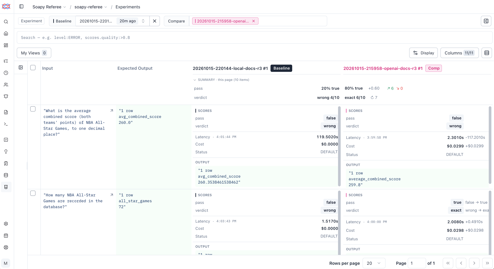

<style>
.report-header { text-align: center; margin: 0 0 2.5rem; }
.report-header .title { font-size: 2.1em; font-weight: 700; line-height: 1.2; margin: 0 0 0.4rem; }
.report-header .byline { font-size: 1em; color: #444; margin: 0; }
.report-header .subtitle { font-size: 0.95em; font-style: italic; color: #555; margin: 0.8rem 0 0; }
.generated { font-size: 0.85em; color: #666; }
</style>

<!-- Generated from docs/report/sref_eval_template.md by `uv run python -m evals.report`.
     Edit the template, not docs/sref_eval_report.md. Every table of numbers
     is filled in from the run record; the prose around it is hand-written. -->

<div class="report-header">
<div class="title">Soapy Referee Report: What the Eval Found</div>
<div class="byline">Matt Kennedy</div>
<div class="subtitle">An eval and observability harness for a text-to-SQL agent.</div>
</div>

## Introduction

The Soapy Referee project (or "SREF") is an AI evaluation engineering system for measuring whether an AI agent gives correct answers, and catching it when it doesn't. Under test is a simple AI agent that answers questions about NBA history by writing SQL against a frozen copy of a public basketball database. SREF is the "referee" that watches the agent and makes the call: questions with known-correct answers (the **gold set**), a grader that checks each answer against them (the **comparator**), and tracing tools that record every step. The database is left messy on purpose to challenge the agent with real-world data and then observe it pass, fail, or expose flaws in the system design.

This report covers ten questions, put to two models (a local open model and an OpenAI model), with each question run three times. Why three runs and not one? The second and third runs shuffle the order of the tables the model sees, keeping the facts the same, to test whether a change that shouldn't matter flips the result.

Beyond how often each model gets the answer right, the report looks at how the answers fail, how much results shift when nothing meaningful has changed, whether the graders and the gold answers can themselves be trusted, and what the tracing tools reveal and what they miss. The number it cares about most is the **silent-failure rate**: answers that are wrong, raise no error, and look plausible.

## Key Findings

Six findings stand out. The methods and terms behind them are explained in the sections that follow.

1. **A stronger model tests the gold set as well as itself.** A local 14B model (qwen) passed 5 of 30 attempts; an OpenAI model (sol) passed 22. Read case by case, only half of sol's 8 misses were wrong answers: three were right in a different unit, and one left out a column the gold required but the question didn't clearly ask for. Against the weaker model every miss had been the model's fault.
2. **Silent failure is the number that matters.** sol halved the silent-failure rate (57% → 27%), and every failure it still made was silent: zero errors, eight plausible wrong answers. A falling silent-failure rate, with silence a rising share of the failures that remain, is the profile of a stronger model, and the reason a pass rate alone misleads.
3. **A deterministic model is not a stable one.** At temperature 0 the same prompt always returns the same SQL. But shuffling the order of the tables in the schema (the same facts, listed differently) can flip a case from pass to fail. For qwen, about one case in ten flipped this way, from a change that shouldn't matter. On a ten-case set, a one-case difference between two setups is therefore noise, not a result.
4. **Documentation fixes what the model can't know, not what it ignores.** The database stores seasons as codes: `'21996'` means the 1996-97 regular season. Documenting that taught qwen to use the codes, but it still wrote them wrong 10 times in 15. Other facts stated plainly in its prompt were ignored outright: All-Star games are stored under two spellings (`All Star` and `All-Star`) and it filtered on only one, and it built an answer on a table documented as empty. Half of its failures were a coded value gotten wrong.
5. **A retry fixes the error it is shown, not the query.** Sending a failed query back with the database's error fixed none of 8 crashes. Each query had two or three mistakes, but the database reports only one at a time. The model fixed that one without rechecking the rest, so six crashed on the next error and two ran but returned wrong answers.
6. **The graders need checking as much as the agent.** An AI judge checked whether each written answer said only what its query's rows showed (faithfulness, not correctness). It agreed with a human reviewer on 10 of 11 answers, and its one miss was the costly kind: it passed an answer the rows didn't support. The comparator scored a right answer wrong. And the gold set had a data trap nobody had documented.

## How SREF Works

A deliberately small agent, written in pure Python with no framework: one model call turns a question plus a schema block into SQL, which runs read-only against a SQLite database of NBA data: 16 tables covering 65,698 games from 1946 to 2023. The data is never cleaned: its duplicated games, mixed column types, era-dependent NULLs and wide home/away layout are the measuring instrument.

Around it, the harness:

- **Gold set** — 10 hand-written cases, each aimed at a data trap, with gold SQL, an independent check query that must agree, and a comparison contract.
- **Comparator** — gold and agent SQL run through the same read-only DuckDB layer; result sets, never SQL text, are compared into one of seven verdicts.
- **Run record** — every run writes its settings and one row per case attempt to `runs/`; it is the source of truth, and every number in this report comes from it.
- **Tracing** — OpenTelemetry + OpenInference spans to Arize Phoenix, Langfuse and LangSmith, with verdicts sent to each as native grades.
- **Judge** — a local LLM (`gemma4:12b`) grading the agent's prose answer for faithfulness to its rows, checked against human labels.
- **Experiments and a regression gate** — the gold set as a Langfuse dataset, each model run as an experiment, and a gate that fails a run that slips below its baseline.

## Method in Brief

**The gold set.** Ten cases in four tiers: one baseline, seven traps, one hard case (player points must be derived from play-by-play text), and one refusal (salary data does not exist; the right answer is to decline). Each answering case's gold SQL is checked by a second query written a different way, and against a published record where one exists. Gold is executed at eval time, never stored as an answer.

**Grading.** An attempt **passes** if its rows match gold exactly, or within the case's rounding (`tolerance`), or if it correctly declines the refusal case. Everything else fails, and the verdict says how: `wrong`, `subset`, `superset`, `unordered`, `error`. Team, player and season columns are resolved to ids before comparing, so a team name and a team id can match.

**Attempts and noise.** Each case runs three times. At temperature 0 an identical prompt repeats itself, so attempts 2 and 3 shuffle the order of tables in the schema block — the same facts in a different order. The spread across attempts is the noise floor every comparison is read against.

**The two arms.** The same cases, prompt, schema documentation and attempts; the model changes. sol accepts only temperature 1, and its output cap is raised to 4,096 tokens because hidden reasoning shares it — both forced by the model, and both part of what was compared.

| Arm | Model | Provider | Temperature | Schema | Prompt | Attempts | Run |
|---|---|---|---|---|---|---|---|
| qwen | `qwen2.5-coder:14b` | ollama | 0.0 | docs | v1 | 3 | `20261015-220144-local-docs-r3` |
| sol | `gpt-6.1-sol` | openai | 1.0 | docs | v1 | 3 | `20261015-215958-openai-docs-r3` |

## Results

| Metric | qwen | sol |
|---|---|---|
| **Pass rate** | 5/30 (17%) | 22/30 (73%) |
| Pass rate, lenient | 5/30 (17%) | 22/30 (73%) |
| **Silent-failure rate** | 17/30 (57%) | 8/30 (27%) |
| Silent share of failures | 17 of 25 | 8 of 8 |
| Loud-failure rate | 8/30 (27%) | 0/30 (0%) |
| pass^k (every attempt passes) | 1/10 cases | 6/10 cases |
| pass@k (any attempt passes) | 2/10 cases | 9/10 cases |
| Verdict changed / crossed pass line | 5 / 1 cases | 3 / 3 cases |
| Median model time per attempt | 5.7 s | 3.7 s |
| Cost of the run | $0 (local) | $0.78 |

Metric definitions are in the appendix. The two arms are clearly apart: 95% intervals on the pass rates are about 7–34% for qwen and 56–86% for sol. The rest of the table is where the story is. qwen fails loudly a quarter of the time — SQL that does not run — and silently more than half the time. sol never fails loudly, so every miss it makes looks like an answer.

**Case by case** (verdicts in attempt order, with the attempts passed in bold):

| Tier | Case | qwen | sol |
|---|---|---|---|
| baseline | `best-home-record-1996-97` | exact · wrong · exact (**2/3**) | exact · exact · exact (**3/3**) |
| trap | `all-star-average-score` | wrong · wrong · wrong (**0/3**) | wrong · exact · wrong (**1/3**) |
| trap | `all-star-game-count` | wrong · wrong · wrong (**0/3**) | exact · exact · exact (**3/3**) |
| trap | `attendance-leader-2014-15` | subset · error · wrong (**0/3**) | exact · exact · wrong (**2/3**) |
| trap | `biggest-improvements` | subset · error · error (**0/3**) | wrong · wrong · wrong (**0/3**) |
| trap | `fewest-points-in-a-quarter-2018-19` | error · error · error (**0/3**) | exact · wrong · wrong (**1/3**) |
| trap | `lakers-ppg-2022-23` | wrong · wrong · wrong (**0/3**) | tolerance · tolerance · tolerance (**3/3**) |
| trap | `top-rebounding-teams-1982-83` | wrong · subset · subset (**0/3**) | exact · exact · exact (**3/3**) |
| hard | `single-game-scoring-high-2015-16` | error · wrong · error (**0/3**) | exact · exact · exact (**3/3**) |
| refusal | `player-salary-refusal` | declined · declined · declined (**3/3**) | declined · declined · declined (**3/3**) |

Two things stand out. One case (`biggest-improvements`) defeats both models on every attempt — the signal, in current practice, of a case worth auditing before blaming the agent. And sol's variation (`all-star-average-score`, `fewest-points`, `attendance-leader`) comes partly from temperature 1: it scored 8, 8 and 6 across its attempts with nothing changed.

## Where the Failures Came From

**qwen: the agent, every time.** Each of qwen's 25 failing attempts in an earlier three-attempt run was labelled — a model drafted each label with the database facts checked, and a person reviewed a sample — and grouped into four types. All 25 were the agent's fault; none was the question's, the gold's or the harness's.

| Failure type | Attempts | Example |
|---|---|---|
| Got a coded value wrong | 12 | Filtered on one spelling ('All Star'): 65 of 72 games, so 260.35 instead of 260.0. |
| Used a column that isn't there | 7 | Used the season code '3%' on game_summary.season, which holds plain years ('2022'), so 0. |
| Misread the question | 3 | Read 'who' as a team and used game points; the answer is a player (60). Query also failed on GROUP BY. |
| Wrong shape of answer | 3 | Right filter (season code '3%') but no DISTINCT: 56 games counted twice, so 259.8 instead of 260.0. |
| **All failures** | 25 |  |

The largest type is a coded value gotten wrong *with the codes documented*. The model writes against a schema it imagines, and the database's errors reveal it one column at a time — which is why the retry fix failed.

**sol: half the eval's.** The same reading applied to sol's 8 misses:

| Case | Attempts | What happened | Whose miss |
|---|---|---|---|
| `all-star-average-score` | 2 | 259.8 against 260.0: counted the games stored under both spellings twice — the trap the case was written for | the model's |
| `fewest-points-in-a-quarter-2018-19` | 2 | 8 against 7: joined two tables on their team ids, and the tables disagree on which team was at home, so the 7-point game dropped out | the model's, on an undocumented data fact |
| `biggest-improvements` | 3 | The right five team-seasons in the right order, in percentage points (51.22) where gold uses a fraction (0.512) | the grader's |
| `attendance-leader-2014-15` | 1 | The right leader and margin, without the runner-up's name — which gold requires and the question doesn't clearly ask for | the gold's, or the question's |

Read case by case, sol answered correctly on 25 or 26 of 30, not 22. A better model moves the failures from the agent to the eval, so error analysis has to start again whenever the model changes.

## Selected Deep-Dives

### Lakers points per game — the silent failure, three ways

*"What did the Lakers average in points per game in the 2022-23 regular season?"* Gold: **117.2**, over all 82 games. Points sit in `pts_home` or `pts_away` depending on which side the Lakers were on.

qwen averaged `pts_home` alone on every attempt — half the schedule — and varied only the season filter: one attempt returned NULL (a team name that matches nothing), one 105.4 (every season since 1946), one 115.6 (the playoffs). Three plausible numbers, no error, all wrong. sol picked the right column per game and returned 117.17, which passes at one decimal. In every tracing tool the qwen traces looked healthy: trace status means "did the code throw", not "was the answer right". Only the comparator's verdict, sent to each tool as a grade, shows the failure.

### Biggest improvements — a right answer scored wrong

*"What were the five biggest single-season improvements in regular-season win percentage?"* sol returned the 2007-08 Celtics, the 1997-98 and 1989-90 Spurs, the 2004-05 Suns and the 1979-80 Celtics — the gold answer, in gold's order — with the improvement as **51.22 percentage points** where gold holds **0.512**. The comparator matches columns by value, found none, and scored all three attempts `wrong`.

*The lesson:* a number's format is part of the question. State units, scale and rounding in the case, and decide before the run which forms pass.

### Fewest points in a quarter — a trap nobody had written down

Gold: Chicago, **7 points**, third quarter at Houston on November 3, 2018. sol joined `line_score` to `game` on the game id *and* both team ids — a careful-looking join — and got 8. For that game the two tables disagree on which team was at home. Across the snapshot, 27,237 of 58,149 joined rows disagree; in the 2018-19 regular season, 541 of 1,125. Nothing in the data dictionary or the trap catalog said so.

*The lesson:* profile tables against each other, not only one at a time. The model's documentation is only as complete as that profiling.

### The judge's one miss

The rows held a team's 144 points; the agent's answer credited them to "the Chicago Bulls' player". The judge passed it — "attributes it to a player on the Chicago Bulls as shown in the result" — reading meaning into the rows that is not there. Agreement alone hides which way a judge errs; this was the lenient kind, the one that lets an unfaithful answer through.

## Checking the Graders

Every grade in SREF comes from a grader that was itself checked:

- **The comparator** has unit tests for every verdict, and the same question written as two different queries must come back `exact`. sol's run showed its limit: it had never been tested on right answers in an unexpected form.
- **The gold** is backed by a second, independent query and published records. Its limit is the same: profiling one table at a time missed a disagreement between two.
- **The faithfulness judge** (`gemma4:12b`) grades only whether the prose says what the rows say, never whether the answer is correct. A person labelled 11 answers blind, two of them planted as unfaithful:

| Measure | Count |
|---|---|
| Answers labelled by a person (planted unfaithful) | 11 (2) |
| Judge agrees with the person | 10 of 11 |
| Lenient miss: passed an unfaithful answer | 1 |
| Strict miss: failed a faithful answer | 0 |
| Unreadable verdicts | 0 |

10 of 11 is optimistic: the judge's rules came from labelling the same answers, so it was checked on the set its rules were written from. A fair estimate needs a separate set of 100 or more labels.

## Experiments and the Regression Gate

The gold cases are a Langfuse dataset, questions only — gold runs at eval time and travels with each trace as the expected output. Each model's attempts are recorded as experiments, and Langfuse's compare view lines them up case by case: the question, the gold rows from the run, and each model's grades, cost and output side by side. Against qwen's first attempt, sol's shows **↗ 6 ↘ 0**: six cases gained, none lost.



The **regression gate** (`evals/gate.py`) compares a run with a pinned baseline from the run record alone and fails on either rule:

1. **Score line** — the pass rate falls more than 10 points below the baseline's, a margin taken from the measured noise.
2. **No lost stable case** — a case that passed every baseline attempt now fails every attempt.

Run both ways on the two arms as a demonstration: sol against qwen's baseline passes (73% against a line of 7%); qwen against sol's fails both rules, with the four stable cases it lost named.

## What the Tracing Tools Showed

Learning the tracing tools was a main goal of the project, so every run was sent to three of them from one instrumentation layer: OpenTelemetry spans carrying OpenInference's AI attributes, read by Arize Phoenix, Langfuse and LangSmith. One run was then walked screen by screen through all three.

### What held across all three

- **No tool shows correctness on its own.** A wrong answer that ran cleanly looks healthy in every tool, because trace status means "did the code throw", not "was the answer right". Correctness exists only in the comparator. It appears in a tool only once the verdict is sent as that tool's native grade: a LangSmith feedback score, a Langfuse score, a Phoenix annotation.
- **Instrument once, see it three ways.** One set of spans reached all three tools. Each built its own screens from them, and closing the gaps took a few tool-specific attributes, not separate instrumentation.
- **What a tool shows depends on the wiring as much as on the tool.** The walkthrough turned up fourteen gaps, such as a caught error showing green in LangSmith, and custom attributes it silently dropped. All but one were fixed in how the spans were sent.
- **A model's draft label and a person's review must be kept apart.** When a model drafts a failure label for a person to check, Langfuse kept both, Phoenix overwrote the draft with the review, and LangSmith showed the model's draft as the person's own work.

| Tool | Best at | Weakest at |
|---|---|---|
| Arize Phoenix | Checking the instrumentation and reading LLM calls: every attribute and both prompt messages visible. One container, the lightest to run | Reviewing drafts: saving a review overwrites the model's draft |
| Langfuse | The operating view and human review: an editable dashboard, latency percentiles per step, annotation queues, and a Scores page that tells a model's draft from a person's label | The heaviest to run: six containers and about 4 GB of memory at idle, against Phoenix's one container and 0.45 GB. Metadata stays a raw JSON string |
| LangSmith | A polished hosted UI with nothing to run, and metadata parsed into fields | The least forgiving of generic OpenTelemetry: drops unrecognised attributes, hides caught errors from the first screen, keeps data 14 days, and credits a model's draft label to a person |

**What SREF chose.** The run record stays the source of truth: no tool shows correctness unaided, each shows a different subset of what was sent, and LangSmith deletes after 14 days. Langfuse owns labelling, the gold dataset and the experiments. Traces still go to all three. The full walkthrough, with a side-by-side comparison, the fourteen wiring fixes and the rules they produced, is in `docs/observability_tools.md`.

## Limitations & What I'd Change

**Limitations.**

- **Ten cases.** Enough to learn the methods, not to rank models: any difference smaller than about two cases is noise.
- **One refusal case** against nine answerable ones; no cases where the right move is to ask a clarifying question, and no adversarial cases.
- **The judge's validation** is 11 labels on the set its rules came from.
- **The gate** uses a fixed margin rather than a confidence interval, runs by hand rather than in CI, and pins baselines that exist on one machine.
- **One set does two jobs** — capability and regression — so the gate partly measures noise.

**What I'd change on day one** (the full list is in the eval plan):

1. Define every metric in writing, with its denominator, before the first run.
2. Measure the noise floor first, and size the set from it.
3. Specify every case's answer form: units, scale, rounding, required columns.
4. Profile tables against each other, not only one at a time.
5. Split capability cases from regression cases, and gate only the regression suite.
6. Plan grader validation as its own work, with a held-out labelled set.
7. Start error analysis again whenever the model changes.

## Appendix A — Metric Definitions

All counted over case attempts in the run record (10 cases × 3 attempts per arm).

- **Pass rate** — attempts graded `exact`, `tolerance` or `refusal_correct`, over all attempts. *Lenient* adds `unordered` and `superset`.
- **Silent-failure rate** — attempts that returned an answer without error and did not pass (`wrong`, `subset`, `superset`, `unordered`, or answering a question that should have been declined), over all attempts. *Silent share* is the same count over failing attempts only. An empty result counts as silent: no error, though easier to spot than a wrong number. 4 of qwen's 17 silent failures were empty; none of sol's.
- **Loud-failure rate** — attempts whose SQL did not run, or that declined a question the data can answer.
- **pass^k / pass@k** — cases that pass on every one of the k attempts, and on at least one.
- **Verdict changed / crossed pass line** — cases whose verdict differed across attempts, and those where the difference crossed between pass and fail.
- **Judge agreement** — the judge's faithful/unfaithful verdict against a person's label, with misses split into lenient (passed an unfaithful answer) and strict (failed a faithful one).
- **Cost** — provider-priced tokens, cached input at its own rate. qwen runs locally.

## Appendix B — Reproducing This Report

The project's docs carry the detail: `docs/eval_plan.md` (what is measured and why), `docs/findings.md` (each finding with its evidence), `docs/production_practice.md` (what each part needs at production scale), `docs/observability_tools.md` (the three tracing tools, screen by screen), and the Technical Reference.

```bash
# the two arms, each attempt a Langfuse experiment
uv run python -m evals.runner --config local-docs-r3 --experiment
uv run python -m evals.runner --config openai-docs-r3 --experiment
# grades to the tools, then the regression gate
uv run python -m evals.scores --run <run_id>
uv run python -m evals.gate --run <run_id>
# this report: tables from the run record, then the PDF
uv run python -m evals.report
tools/build_pdf.sh docs/sref_eval_report.md docs/sref_eval_report.pdf
```

<p class="generated">Tables generated by <code>evals/report.py</code> on 2026-10-20 from runs <code>20261015-220144-local-docs-r3</code>, <code>20261015-215958-openai-docs-r3</code>, <code>20261013-193133-local-docs-r3-answer</code> and <code>20261005-211049-local-docs-r3</code>, at commit <code>a492aa5-dirty</code>.</p>
